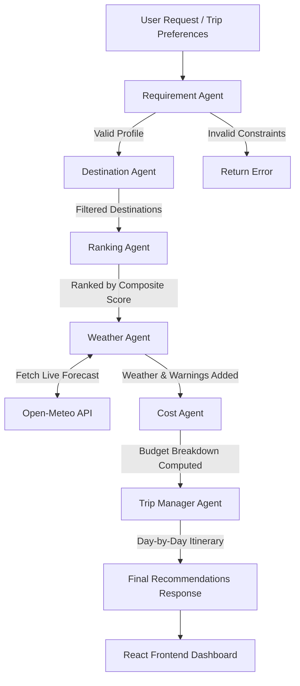

# 🌄 Weekend Trip Planner (WeekendEscapes)

> **An intelligent, multi-agent AI system for personalized weekend getaway recommendations, real-time weather forecasts, budget breakdowns, and automated day-by-day itineraries.**

[](https://fastapi.tiangolo.com)
[](https://react.dev/)
[](https://vitejs.dev/)
[](https://www.python.org/)
[](LICENSE)
[]()

---

## 📖 Table of Contents

- [Overview](#-overview)
- [Key Features](#-key-features)
- [Multi-Agent Architecture](#-multi-agent-architecture)
- [Project Structure](#-project-structure)
- [Tech Stack](#-tech-stack)
- [Getting Started](#-getting-started)
  - [Prerequisites](#prerequisites)
  - [1. Backend Setup](#1-backend-setup)
  - [2. Frontend Setup](#2-frontend-setup)
- [Running the Project](#-running-the-project)
- [API Reference](#-api-reference)
- [Running Unit Tests](#-running-unit-tests)
- [Adding New Destinations](#-adding-new-destinations)
- [Roadmap](#-roadmap)
- [License](#-license)

---

## 🌟 Overview

Planning a spontaneous weekend getaway shouldn't take hours of manual research. **Weekend Trip Planner** is a full-stack, AI-agent powered travel assistant that analyzes your travel constraints (departure city, budget, number of travelers, interests, travel time limits, and travel dates) and generates optimal destination options in seconds.

It features a collaborative **multi-agent pipeline** running on **FastAPI**, backed by live meteorological data from **Open-Meteo**, and a responsive **React 19** frontend.

---

## ✨ Key Features

- 🤖 **Multi-Agent Orchestration**: Modular agents handle validation, destination filtering, algorithmic ranking, weather forecasting, financial analysis, and itinerary scheduling.
- 🎯 **Algorithmic Destination Ranking**: Calculates a weighted compatibility score:
  - **Interest Match**: 50%
  - **Destination Rating**: 30%
  - **Travel Time Efficiency**: 20%
- 🌤️ **Live Weather Forecasting**: Integrates directly with the Open-Meteo API using geo-coordinates to retrieve daily high/low temperatures, precipitation totals, and smart weather warnings (e.g. rain alerts).
- 💰 **Transparent Financial Modeling**: Predicts total trip cost itemized by transport, lodging, dining, and activities, indicating whether you are within or over your budget.
- 📅 **Day-by-Day Itineraries**: Synthesizes a structured schedule matching your trip duration with top recommended activities.
- 🧭 **Explore Destination Catalog**: Browse curated destinations with high-resolution imagery, activity tags, travel durations, and direct "Plan Trip" triggers.
- 💾 **Trip Persistence**: Save generated trip plans to browser `localStorage` for quick review or comparison.
- 🎨 **Modern Responsive UI**: Clean interface built with React 19, Lucide icons, glassmorphism, and responsive layout.

---

## 🧠 Multi-Agent Architecture

The backend implements a pipeline where specialized agents refine and enrich trip recommendations sequentially:



### Agent Roles

| Agent | Module | Description |
| :--- | :--- | :--- |
| **Requirement Agent** | [`requirement_agent.py`](backend/app/agents/requirement_agent.py) | Validates user input bounds (budget, days, people, travel hours) and builds normalized profile. |
| **Destination Agent** | [`destination_agent.py`](backend/app/agents/destination_agent.py) | Evaluates destination candidates against maximum travel duration and user interest overlaps. |
| **Ranking Agent** | [`ranking_agent.py`](backend/app/agents/ranking_agent.py) | Computes multi-factor composite scores (interests 50%, rating 30%, travel time 20%) and sorts results. |
| **Weather Agent** | [`weather_agent.py`](backend/app/agents/weather_agent.py) | Calls Open-Meteo API for real-time forecast data and issues rain or adverse weather alerts. |
| **Cost Agent** | [`cost_agent.py`](backend/app/agents/cost_agent.py) | Estimates costs for transport, lodging, meals, and activities vs. your budget. |
| **Trip Manager** | [`trip_manager.py`](backend/app/agents/trip_manager.py) | Organizes destinations and activities into an actionable daily itinerary. |

---

## 📁 Project Structure

```text
weekend-trip-planner/
├── backend/
│   ├── app/
│   │   ├── agents/                     # Modular agents
│   │   │   ├── requirement_agent.py    # Constraint validation & profiling
│   │   │   ├── destination_agent.py    # Travel-time & interest filtering
│   │   │   ├── ranking_agent.py        # Weighted multi-factor ranking
│   │   │   ├── weather_agent.py        # Live weather & alerts analysis
│   │   │   ├── cost_agent.py           # Expense analysis agent
│   │   │   └── trip_manager.py         # Daily itinerary generation
│   │   ├── core/                       # Core configuration
│   │   ├── models/                     # Data models
│   │   ├── schemas/
│   │   │   └── trip_request.py         # Pydantic schemas for request validation
│   │   ├── services/
│   │   │   └── weather_service.py      # Open-Meteo API client
│   │   ├── utils/
│   │   │   └── cost.py                 # Budget calculation formulas
│   │   └── main.py                     # FastAPI application & endpoints
│   ├── requirements.txt                # Python package dependencies
│   └── venv/                           # Python virtual environment (gitignored)
├── data/
│   └── sample_destinations.json        # Curated destination database
├── frontend/
│   ├── public/                         # Static assets
│   ├── src/
│   │   ├── components/                 # React UI components
│   │   │   ├── AuthModal.jsx           # Sign in/up modal
│   │   │   ├── DestinationModal.jsx    # Destination detail dialog
│   │   │   ├── ExploreDestinations.jsx # Destination cards catalog
│   │   │   ├── Hero.jsx                # Landing page hero banner
│   │   │   ├── MyTrips.jsx             # Saved trips manager
│   │   │   ├── Navbar.jsx              # Navigation header
│   │   │   ├── TripPlannerForm.jsx     # Interactive trip planning form
│   │   │   └── TripResults.jsx         # Recommendation & itinerary results
│   │   ├── App.jsx                     # Root application container & state
│   │   ├── App.css                     # Main layout & theme styles
│   │   └── main.jsx                    # React entry point
│   ├── index.html                      # HTML template
│   ├── package.json                    # Node dependencies & scripts
│   └── vite.config.js                  # Vite configuration
├── tests/
│   ├── test_budget.py                  # Unit tests for cost calculation
│   ├── test_ranking.py                 # Unit tests for ranking algorithm
│   └── test_trip.py                    # Unit tests for validation & itinerary
├── .gitignore                          # Git ignore rules
└── README.md                           # Documentation
```

---

## 🛠️ Tech Stack

### Backend
- **Framework**: [FastAPI](https://fastapi.tiangolo.com/) (Python 3.10+)
- **Server**: [Uvicorn](https://www.uvicorn.org/) (ASGI server)
- **Validation**: [Pydantic v2](https://docs.pydantic.dev/)
- **HTTP Client**: [Requests](https://requests.readthedocs.io/)
- **Weather Provider**: [Open-Meteo API](https://open-meteo.com/) (No API key required)

### Frontend
- **Framework**: [React 19](https://react.dev/)
- **Build Tool**: [Vite 8](https://vitejs.dev/)
- **Icons**: [Lucide React](https://lucide.dev/)
- **Styling**: Vanilla Modern CSS (Responsive, Glassmorphism, CSS Custom Properties)

---

## 🚀 Getting Started

### Prerequisites

Ensure you have the following installed on your machine:
- **Python 3.10+** ([Download Python](https://www.python.org/downloads/))
- **Node.js 18+** & **npm** ([Download Node.js](https://nodejs.org/))
- **Git**

---

### 1. Backend Setup

1. Open your terminal and navigate to the `backend` folder:
   ```bash
   cd backend
   ```

2. Create and activate a Python virtual environment:
   - **Windows (PowerShell)**:
     ```powershell
     python -m venv venv
     .\venv\Scripts\Activate.ps1
     ```
   - **macOS / Linux**:
     ```bash
     python3 -m venv venv
     source venv/bin/activate
     ```

3. Install the required Python dependencies:
   ```bash
   pip install -r requirements.txt
   ```

4. Start the FastAPI development server:
   ```bash
   uvicorn app.main:app --reload --host 127.0.0.1 --port 8000
   ```
   > The API will now be live at **`http://127.0.0.1:8000`**.  
   > Interactive API docs (Swagger UI) are available at **`http://127.0.0.1:8000/docs`**.

---

### 2. Frontend Setup

1. Open a new terminal window and navigate to the `frontend` folder:
   ```bash
   cd frontend
   ```

2. Install dependencies:
   ```bash
   npm install
   ```

3. Launch the Vite development server:
   ```bash
   npm run dev
   ```
   > The application will open at **`http://localhost:5173`**.

---

## 🌐 Running the Project

To run both services simultaneously, keep two terminal tabs open:

| Service | Command | URL |
| :--- | :--- | :--- |
| **Backend (FastAPI)** | `uvicorn app.main:app --reload` | [`http://127.0.0.1:8000`](http://127.0.0.1:8000) |
| **API Docs (Swagger)** | Automatically served by FastAPI | [`http://127.0.0.1:8000/docs`](http://127.0.0.1:8000/docs) |
| **Frontend (React)** | `npm run dev` | [`http://localhost:5173`](http://localhost:5173) |

---

## 📡 API Reference

### Health Check

```http
GET /
```

**Response:**
```json
{
  "message": "Weekend Trip Planner API is running!"
}
```

---

### Plan Trip

```http
POST /plan-trip
Content-Type: application/json
```

#### Request Body Schema

| Field | Type | Required | Description | Example |
| :--- | :--- | :--- | :--- | :--- |
| `location` | `string` | Yes | Starting city / origin | `"Delhi"` |
| `budget` | `number` | Yes | Total budget in local currency (must be > 0) | `15000` |
| `days` | `integer` | Yes | Total trip duration (must be > 0) | `2` |
| `people` | `integer` | Yes | Number of travelers (must be > 0) | `2` |
| `relationship`| `string` | Yes | Travel group type (`solo`, `couple`, `friends`, `family`) | `"couple"` |
| `interests` | `array[string]`| Yes | Preferred activity categories | `["mountains", "trekking"]` |
| `max_travel_hours`| `integer` | Yes | Max one-way travel duration in hours | `6` |
| `start_date` | `string (YYYY-MM-DD)` | Yes | Departure date | `"2026-10-25"` |

#### Example Payload

```json
{
  "location": "Delhi",
  "budget": 15000,
  "days": 2,
  "people": 2,
  "relationship": "couple",
  "interests": ["mountains", "trekking"],
  "max_travel_hours": 6,
  "start_date": "2026-10-25"
}
```

#### Example Response (Truncated)

```json
{
  "message": "Trip recommendations ready",
  "profile": {
    "starting_location": "Delhi",
    "budget": 15000.0,
    "days": 2,
    "people": 2,
    "relationship": "couple",
    "interests": ["mountains", "trekking"],
    "max_travel_hours": 6,
    "start_date": "2026-10-25"
  },
  "destinations": [
    {
      "name": "Dharamshala",
      "state": "Himachal Pradesh",
      "travel_hours": 4,
      "rating": 4.5,
      "activities": ["mountains", "peaceful", "trekking", "nature"],
      "interest_match": 2,
      "score": 0.836,
      "weather": {
        "time": ["2026-10-25", "2026-10-26"],
        "temperature_2m_max": [20.6, 20.7],
        "temperature_2m_min": [14.7, 15.0],
        "precipitation_sum": [0.0, 0.0]
      },
      "weather_warning": "No rain is currently forecast.",
      "cost": {
        "transport": 1200,
        "hotel": 2400,
        "food": 2000,
        "activities": 2400,
        "total": 8000,
        "budget": 15000.0,
        "status": "within_budget",
        "difference": 7000.0
      }
    }
  ],
  "itinerary": [
    {
      "day": 1,
      "destination": "Dharamshala",
      "activities": ["mountains", "peaceful"]
    },
    {
      "day": 2,
      "destination": "Kasol",
      "activities": ["mountains", "trekking"]
    }
  ]
}
```

---

## 🧪 Running Unit Tests

The project includes unit test coverage for budget calculations, destination ranking logic, requirement validation, and itinerary composition.

From the repository root, run:

```bash
# Using python directly (with venv activated)
python -m unittest discover -s tests

# Or specify the python executable explicitly:
.\backend\venv\Scripts\python.exe -m unittest discover -s tests
```

Expected output:
```text
......
----------------------------------------------------------------------
Ran 6 tests in 0.001s

OK
```

---

## 🗺️ Adding New Destinations

To expand the recommendation catalog, edit [`data/sample_destinations.json`](data/sample_destinations.json):

```json
{
  "name": "Shimla",
  "state": "Himachal Pradesh",
  "latitude": 31.1048,
  "longitude": 77.1734,
  "travel_hours": 7,
  "rating": 4.5,
  "activities": [
    "mountains",
    "nature",
    "peaceful",
    "sightseeing"
  ]
}
```

- `latitude` and `longitude`: Used for live Open-Meteo weather lookups.
- `travel_hours`: Evaluated against `max_travel_hours`.
- `activities`: Compared against user `interests`.
- `rating`: Contributes to ranking score calculation.

---

## 🗺️ Roadmap

- [ ] **Interactive Map View**: Leaflet / Mapbox integration to visualize destinations and routes.
- [ ] **Real-Time Transport Options**: Train/bus timetable and flight price integrations.
- [ ] **User Accounts & Cloud Sync**: PostgreSQL / SQLite backend with Supabase or Firebase Auth.
- [ ] **AI Conversational Assistant**: Generative LLM agent for personalized trip storytelling and activity advice.
- [ ] **PDF Itinerary Export**: One-click download of your customized weekend travel plan.

---

## 📄 License

This project is licensed under the [MIT License](LICENSE).

